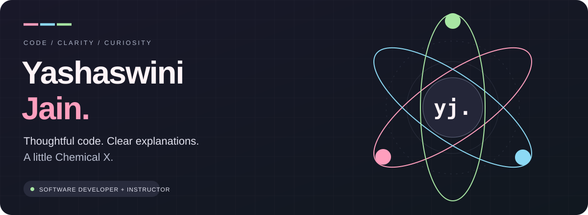

  

  <h3>Building useful software. Making technical ideas click.</h3>
  
Software Developer &amp; Instructor at <strong>AccioJob</strong> · React · Node.js · APIs

  

    <a href="https://yoshjayn.github.io/powerpuff-portfolio/"><strong>✦ Enter my Powerpuff universe</strong></a>
    &nbsp; / &nbsp;
    <a href="https://linkedin.com/in/yashaswinijain">LinkedIn ↗</a>
    &nbsp; / &nbsp;
    <a href="mailto:aswiniy68@gmail.com">Say hello ↗</a>
  

  
Hyderabad, India · Open to full-time roles in Delhi NCR and India-remote teams

---

## 01 / The person behind the code

Hi, I'm **Yashaswini** — a developer, instructor and curious human. I enjoy connecting a thoughtful interface to the logic underneath it, then explaining how the pieces fit together.

- **I build:** React interfaces, Node.js / Express services, REST APIs and authentication flows.
- **I teach:** JavaScript, full-stack development, debugging and problem solving at AccioJob.
- **I bring:** two years of total experience, a mathematics foundation and a habit of asking *why* before *how*.
- **I'm interested in:** software development, solutions engineering and implementation roles where code and communication meet.
- **Beyond code:** photography, playful interfaces and exploring AI applications.

> My favourite kind of progress: something works, and someone understands why.

## 02 / Explore my work

<table>
  <tr>
    <td width="50%" valign="top">
      <h3>✦ Powerpuff Portfolio</h3>
      
A little corner of Townsville for my projects, experience and experiments. Includes CSS animations, project filters, keyboard-friendly tabs and reduced-motion support.

      
<code>HTML</code> <code>CSS</code> <code>JavaScript</code> <code>GitHub Pages</code>

      
<a href="https://yoshjayn.github.io/powerpuff-portfolio/">Explore the universe ↗</a> · <a href="https://github.com/yoshjayn/powerpuff-portfolio">Read the code ↗</a>

    </td>
    <td width="50%" valign="top">
      <h3>◧ Notes Canvas</h3>
      
A React note-taking frontend exploring JWT authentication, protected routes, note CRUD, labels, search and light/dark themes. Connects to a separate API.

      
<code>React</code> <code>Context API</code> <code>Tailwind CSS</code> <code>REST APIs</code>

      
<a href="https://notes-canvas-puce.vercel.app/">Open demo ↗</a> · <a href="https://github.com/yoshjayn/Notes-Canvas">Frontend ↗</a> · <a href="https://github.com/yoshjayn/notes-server">Backend ↗</a>

    </td>
  </tr>
  <tr>
    <td width="50%" valign="top">
      <h3>◎ Vistagram</h3>
      
An Instagram-inspired learning project exploring reusable React components, routing, Context API and API integration through iterative builds.

      
<code>React</code> <code>JavaScript</code> <code>Tailwind CSS</code>

      
<a href="https://instagram-clone-upup.vercel.app/">Open demo ↗</a> · <a href="https://github.com/yoshjayn/Instagram-clone">Frontend ↗</a> · <a href="https://github.com/yoshjayn/Insta-backend">Backend ↗</a>

    </td>
    <td width="50%" valign="top">
      <h3>⌘ JavaScript Documentation</h3>
      
A home for JavaScript learning material. Part of my wider interest in making technical concepts approachable through code and explanation.

      
<code>JavaScript</code> <code>Learning resources</code>

      
<a href="https://javascript-documentation-zeta.vercel.app/">Explore ↗</a> · <a href="https://github.com/yoshjayn/Javascript-Documentation">Read the code ↗</a>

    </td>
  </tr>
</table>

These are personal and learning projects. Demo availability may depend on their hosting and backend services.

<a href="https://github.com/yoshjayn?tab=repositories"><strong>Browse the rest of my experiments →</strong></a>

## 03 / My toolkit

| Area | Tools I work with |
| :--- | :--- |
| **Interfaces** | JavaScript (ES6+), React, Redux Toolkit, Context API, HTML, CSS, Tailwind CSS |
| **Backend & APIs** | Node.js, Express.js, REST APIs, JWT, Socket.IO |
| **Data** | MongoDB, MySQL — joins, subqueries, indexes and transactions |
| **Workflow** | Git, GitHub, Postman, debugging |
| **Foundations** | Java, C++, data structures and algorithms |

## 04 / Building & explaining

### AccioJob · Software Developer & Instructor
**September 2025 — present**

Software development and technical instruction across JavaScript, React, Node.js and APIs. I enjoy helping learners reason through a problem rather than memorise its solution.

**Teaching spotlight — Authentication & Profile Management**  
An AccioJob teaching project using React, Express, MongoDB, JWT, REST APIs and Socket.IO. A practical way to explain how frontend state, authentication and backend persistence connect.

### Remotasks · Freelance AI Training Expert
**March — August 2024**

Contributed to AI model training and evaluation through freelance annotation work.

## 05 / Foundations & recognition

- **Master of Computer Applications** · Manipal University Jaipur · 2023–2025
- **B.Sc. Mathematics** · Maharishi Dayanand University · 2019–2022
- **Humanity's Last Exam, 2025** · Benchmark contribution

---

  
  <h3>Have a useful problem to solve?</h3>
  
Let's talk about the product, the people using it, and what we can build.

  
<a href="mailto:aswiniy68@gmail.com">Email me ↗</a> · <a href="https://linkedin.com/in/yashaswinijain">Connect on LinkedIn ↗</a> · <a href="https://yoshjayn.github.io/powerpuff-portfolio/">Visit my portfolio ↗</a>

